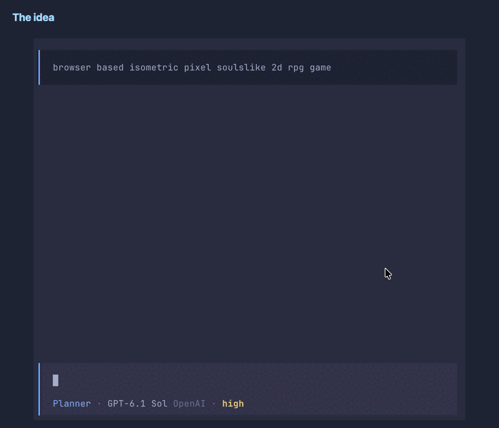
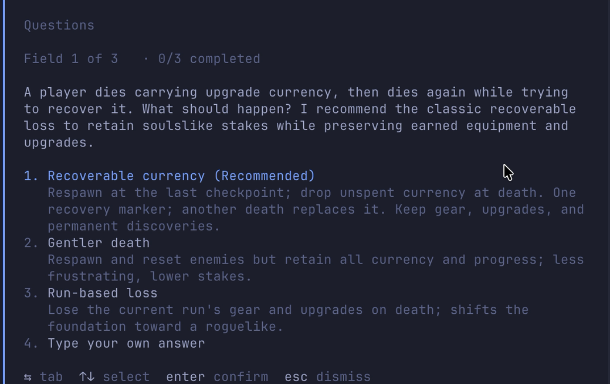
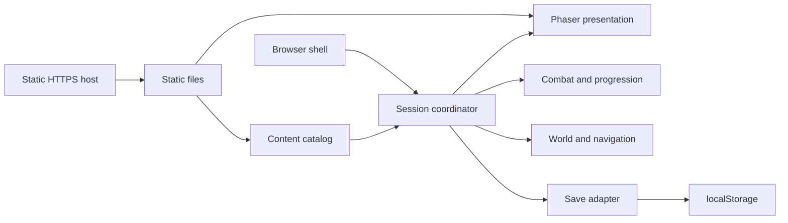

# let-agent-plan

**Resolve the decisions before your coding agent builds.**

An interactive planning workflow for **Claude Code** and **OpenCode v2**.
It researches your project, challenges assumptions, and works through the
important decisions with you. You leave with a Markdown plan—not source-code
changes.

[Watch the real demo](#watch-a-real-planning-session) ·
[See a decision become a plan](#from-an-idea-to-decisions-a-real-example)

## Start here

Choose the tool you already use; install only its recommended distribution:

| Your tool | Start with | What it adds |
| --- | --- | --- |
| **Claude Code** | [Install the plugin](#claude-code--recommended-plugin) | An explicitly invoked planning skill in your conversation. |
| **OpenCode v2** | [Install the primary agent](#opencode-v2--recommended-primary-agent) | A selectable `planner` agent for interactive planning. |

You need a working setup and model access for your chosen tool. The planner is MIT
licensed; your tool's model access, usage limits and costs still apply.
Need the tool itself? See the [Claude Code guide](claude/README.md#install-claude-code)
or [OpenCode v2 guide](opencode/README.md#install-opencode-v2).

### Claude Code — recommended: plugin

Install from your terminal:

```sh
claude plugin marketplace add furkankaynak/let-agent-plan
claude plugin install let-agent-plan@let-agent-plan
```

Open **the project you want to plan**, not this plugin's repository, in a normal
Claude Code session (not built-in Plan mode):

```sh
cd /path/to/your-project
claude
```

Invoke the skill with a concrete feature request, for example:

```text
/let-agent-plan:planner Plan adding team invitations to this app. Read the existing code first. Help me define a small v1. Do not implement anything.
```

The skill starts only when invoked and keeps questions in the current
conversation. [Claude Code guide: updates, alternatives and troubleshooting](claude/README.md).

### OpenCode v2 — recommended: primary agent

Install from your terminal (macOS / Linux). If you already have a custom
`~/.config/opencode/agents/planner.md`, back it up first; this replaces that file.

```sh
mkdir -p ~/.config/opencode/agents
curl -fsSL https://raw.githubusercontent.com/furkankaynak/let-agent-plan/main/opencode/agents/planner.md \
  -o ~/.config/opencode/agents/planner.md
```

Open **the project you want to plan**, then select **`planner`** from OpenCode's
agent list:

```sh
cd /path/to/your-project
opencode
```

Send the same example request, without a slash command:

```text
Plan adding team invitations to this app. Read the existing code first. Help me define a small v1. Do not implement anything.
```

[OpenCode guide: symlink installation, updates and troubleshooting](opencode/README.md).

### What happens next?

**Research → understanding map → questions → scope confirmation → full plan.**

This is a conversation, not an instant outline: answer the questions and confirm
the scope before the planner designs the solution. It presents the full plan in
chat and, when saving succeeds, writes it inside your project. For a new idea,
open an empty target directory first and describe the idea instead of the example
feature above. There is no fixed session duration or question count.

## Why not just use built-in Plan mode?

Already know the scope and decisions? Your agent's built-in Plan mode may be
enough. Use `planner` when **the decisions themselves need work**: who it is for,
what belongs in v1, what can fail, and how your answers change the delivery plan.

It reads the relevant context before asking, separates facts from assumptions,
explains trade-offs with concrete scenarios, and confirms scope before design.
Those decisions feed into milestones, dependencies and testable acceptance
criteria. The distinction is this prescribed decision-making workflow—not that
built-in modes cannot research or ask questions.

See it in practice below, or [jump to the output and handoff](#what-you-leave-with).

## Watch a real planning session



*34-second edit of a real OpenCode session—not the time needed to make the plan.
All 14 questions are held for 2 seconds each, other session screens for 0.5
seconds, then a labelled excerpt of the saved plan for 2 seconds. Waiting omitted;
implementation stays a separate step. Prefer a static example? See the question
and decision table below.*

## From an idea to decisions: a real example

In a recorded OpenCode session, the starting idea was a **browser-based,
isometric pixel-art soulslike RPG**. Before choosing an architecture, the planner
worked through the combat identity, world scope, progression, death, saves and
asset constraints with the user.

One of its actual questions:

> A player dies carrying upgrade currency, then dies again while trying to
> recover it. What should happen? I recommend the classic recoverable loss
> to retain soulslike stakes while preserving earned equipment and upgrades.

The options explained how recoverable currency, gentler death, or run-based
loss would change the game—not just which one sounded preferable.

<details>
<summary>See the actual question and its options (static image)</summary>



</details>

Those answers became explicit rules in the finished plan:

| Decision | What the plan specifies |
| --- | --- |
| Death and recovery | One recoverable currency marker; another death replaces it. Equipment and upgrades remain. |
| Closing the browser | Progression is saved; reopening starts at the checkpoint, not halfway through combat. |
| Limited art assets | Prove combat readability early with licensed assets and limited animation; do not silently abandon isometric pixel art. |
| First-release scope | One hub, one dungeon, three combat kits and one boss—not a full campaign. |

The result: **four playable milestones**, first-milestone tasks, architecture
diagrams, dependencies and testable acceptance criteria. A saved Markdown plan;
no game source code changed. This is one example, not a fixed template or promise
of identical results from every model.

<details>
<summary>See inside the resulting plan: architecture, milestones and a task</summary>

Selected excerpts from the same session's saved plan—not an implemented game.

### Architecture

Component boundaries: all gameplay executes in the browser; the host only delivers static files.



*Condensed from the plan's component diagram.*

### Four playable milestones

1. **Fight, lose, recover, and continue** in a real isometric scene.
2. **Change builds** and make persistent advancement choices.
3. **Explore and complete** the authored region.
4. **Recover gracefully and release** the playable foundation.

### Example task: T4 — Die, retry, and reclaim currency

**Objective:** close the field → death → checkpoint → recovery journey.

**Scope:** F3 death outcome, checkpoint rest/respawn, transient reset, recovery
marker and safe marker placement. Persistence follows in T5; this session
verifies the real in-session loop, not a stub save.

**Acceptance:** death zeros the wallet, retains durable state, resets the enemy
and restores checkpoint resources; reaching the marker adds its amount once.
Dying again replaces the marker even with an empty wallet. Marker placement
falls back to reachable ground. Rule tests cover replacement and double
recovery; browser test performs death/reclaim and rest/reset.

**dependsOn:** T3.

</details>

## What you leave with

- **A confirmed brief:** problem, users, requirements and a clear v1 boundary.
- **A decision record:** your answers, trade-offs, rejected alternatives and
  assumptions kept separate from verified facts.
- **A technical design:** components, data flow, architecture and sequence
  diagrams; relevant code references and research sources.
- **A delivery plan:** value/risk-ordered milestones, features, dependencies,
  acceptance criteria and focused tasks for the first milestone (all tasks for
  small plans).
- **A durable handoff:** one Markdown file you can review, revise, and use in a
  separate implementation session.

Use it for a **new project**, a **feature in an existing codebase**, or an idea
whose scope needs challenging before anyone starts coding. Small ideas should
still get small plans.

## Review the plan, then build separately

Read the full plan in chat and, if saved, in your project's plan directory:

| Distribution | Plan directory |
| --- | --- |
| Claude Code plugin | `.claude/plans/` |
| OpenCode primary agent | `.opencode/plans/` |
| Portable skill | `plans/` |

Approve the plan or request changes. Claude Code asks permission before writing
to its protected `.claude/plans/` path; if saving is denied or blocked, you still
get the full plan in chat. In any distribution, check the reported save status
rather than assuming a file was created.

When you are ready to build, open a **separate implementation session**, give it
the approved plan's path (or paste the plan if it was not saved), and start with:

> Read the approved plan and implement only its first milestone. Keep later
> milestones out of scope.

The planner does not switch into implementation. Need help getting started?
See [Claude troubleshooting](claude/README.md#troubleshooting) or
[OpenCode troubleshooting](opencode/README.md#troubleshooting).

## Planning, not implementation

- **Never implements.** It researches (files + web), plans and asks — it does
  not edit your source code. Its only write is the finished plan file (below).
- Saves each finished plan to a Markdown file in the project —
  `.opencode/plans/` (OpenCode), `.claude/plans/` (Claude plugin), or `plans/`
  (portable skill) — named
  `{yyyyMMddHHmm}-let-me-plan-{plan_name}.md`, so it survives the session.
- Presents the same full plan in chat, including all sections and diagrams,
  before asking for approval—not just a saved path or summary. If saving fails,
  it still delivers the full plan in chat and reports that it wasn't saved.
- Works toward an approved plan through research, questions and design;
  implementation stays a separate step.

The skills instruct the model not to implement; they do not enforce a tool
sandbox. Normal session permissions apply. The OpenCode agent additionally
declares edit permissions in its harness-specific configuration.

<details>
<summary>Development: repo layout, generated files and migration notes</summary>

### Repo layout

```
src/prompt.md                              # shared prompt source
scripts/build.mjs                          # renderer + artifact frontmatter
scripts/harnesses.json                     # profile replacements and outputs
.claude-plugin/marketplace.json            # discovery entry, points to ./claude
claude/.claude-plugin/plugin.json          # Claude plugin manifest
claude/.claude-plugin/icon.png             # generated icon
claude/agents/planner.md                   # generated Claude agent
claude/skills/planner/SKILL.md              # generated Claude-only skill
claude/README.md                           # Claude guide
opencode/agents/planner.md                 # generated OpenCode agent
opencode/README.md                         # OpenCode guide
skills/planner/SKILL.md                     # generated portable skill
skills/planner/README.md                    # portable skill guide
```

The agents, skills and icon are generated. To regenerate them after editing
`src/prompt.md`, the build configuration or the icon design:

```sh
npm run build   # regenerate ALL four prompts, including the skills.sh skill
npm run icon    # regenerate the plugin icon
npm test        # build, compatibility and documentation checks
```

The build has independent Claude, OpenCode and generic profiles. A profile lists
its replacements and artifacts; an artifact selects its frontmatter separately.
New harnesses do not need an agent artifact just to produce a skill. Edit the
shared source/configuration, not the generated Markdown. See [AGENTS.md](AGENTS.md)
for validation and release instructions.

### Layout migration

The Claude plugin moved under `claude/`. Its marketplace name, plugin name and
`let-agent-plan:planner` agent are unchanged. Invoke the Claude skill as
`/let-agent-plan:planner`. Existing plugin users should update the marketplace and plugin; they
do not need a new marketplace registration. The old root `agents/planner.md`
path is no longer shipped. The portable variant lives under `skills/planner/`,
not inside the Claude plugin.

As of 0.1.8, every skill and agent is named `planner`. The Claude skill command
changes from `/let-agent-plan:plan` to `/let-agent-plan:planner`. Existing
standalone `let-agent-plan` skill installs need migration, not just an update:
remove the old skill in its installed scope and install `planner` instead. See
the [portable skill guide](skills/planner/README.md). The plugin and repository
names stay `let-agent-plan`; the Claude agent name is unchanged.

</details>

## Alternative: skill-only installation via skills.sh

**For Claude Code, prefer the plugin above. For OpenCode v2, prefer the primary
agent above.** Those are the harness-specific distributions. This alternative
installs only the portable skill, not the plugin or a primary agent.

Requires Node.js compatible with the skills CLI (the current upstream docs
specify 22.20+). Install from this public GitHub repository:

```sh
npx skills add furkankaynak/let-agent-plan --skill planner
```

Choose your agent when prompted. Installation is project-local by default;
add `-g` for a user-wide install. Do not install the portable skill alongside
the existing distribution in the same session unless you intentionally want
both variants.

The portable skill uses the current harness's question tool if available;
otherwise it asks in chat and waits for your answers. It saves plans to `plans/`
at the project root, or returns the full plan in chat if writing is blocked.
Invocation and permissions depend on your agent; compatibility is not guaranteed
for every agent supported by the installer.

See the [portable skill guide](skills/planner/README.md) for explicit agent
selection, updates and removal. The intended directory page is
[skills.sh/furkankaynak/let-agent-plan/planner](https://skills.sh/furkankaynak/let-agent-plan/planner).
Installation uses GitHub directly and does not depend on that page being indexed.
skills.sh lists skills through installation telemetry; visibility and cache
refreshes may lag behind a successful install. There is no separate npm publish.

## Show what you planned

Tried it on a real project? Share a question that changed your approach or a
sanitized excerpt of the resulting plan in
[an issue](https://github.com/furkankaynak/let-agent-plan/issues).
Concrete examples and feedback help improve the planner. If it helped you,
consider starring the repo so you can find it again.

## License

MIT
